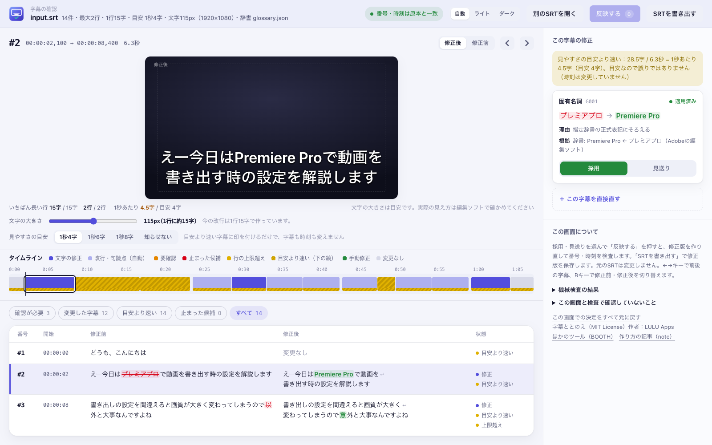
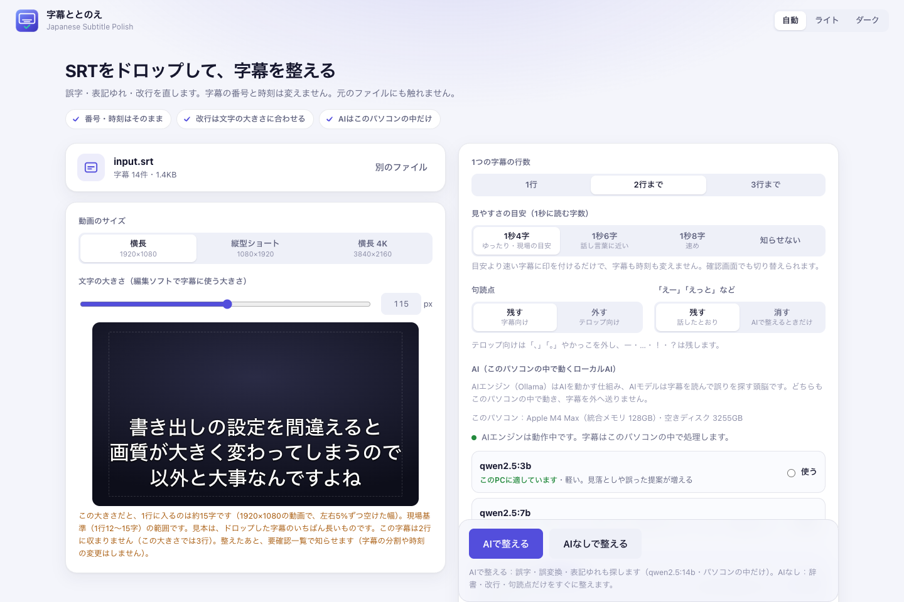
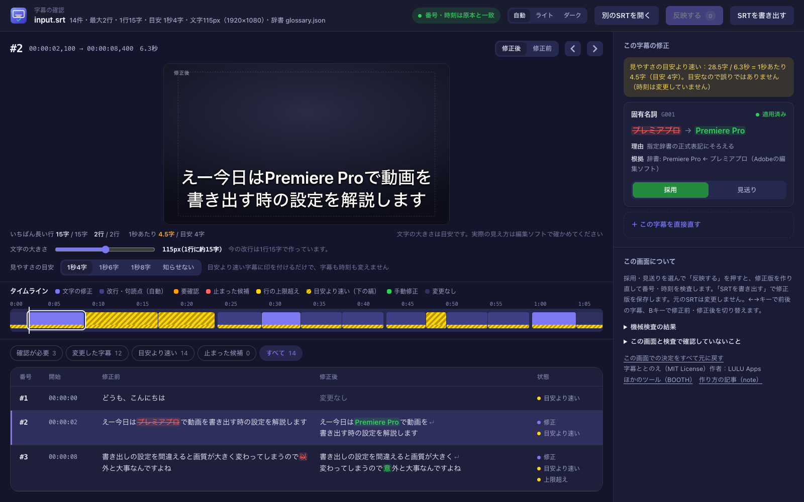

# Japanese Subtitle Polish（日本語字幕ととのえ）


▶ **[紹介動画（50秒）](docs/subtitle-polish-pv.mp4)**：できること・できないことを短くまとめました（ナレーションは [Koe Studio](https://github.com/luluoneone/koe-studio) の Gemini TTS。BGM は購入素材のため、動画は MIT License の対象外です。[THIRD_PARTY_NOTICES.md](THIRD_PARTY_NOTICES.md)）。

Whisperや動画編集ソフトから書き出した**日本語のSRT字幕**を、**番号と時刻を1ミリ秒も動かさずに**整える、無料のアプリです。
SRTを画面にドロップするだけで使えます。Claude Code や Codex から使う Agent Skill としても動きます。

- 誤字・誤変換・表記ゆれ・固有名詞を直す
- 日本語の語の途中を避けて、改行を整える（行頭・行末の禁則は W3C「日本語組版処理の要件」に合わせています）
- 直した箇所は「変更一覧」、文字だけでは決められない箇所は「要確認一覧」にまとめる
- **確認画面**で、字幕を映像の枠に重ねて確かめ、修正ごとに「採用／見送り」を選べる
- テロップ向けに、句読点を外す表記も選べる

```text
修正前  #3  00:00:08,400 --> 00:00:16,800
  書き出しの設定を間違えると画質が大きく変わってしまうので以外と大事なんですよね

修正後  #3  00:00:08,400 --> 00:00:16,800      ← 時刻はそのまま
  書き出しの設定を間違えると画質が大きく
  変わってしまうので意外と大事なんですよね
```



> AIにSRTを丸ごと書き直させる方法はとりません。AIは「どの字幕の、どの文字を、なぜ直すか」という**修正候補**だけを作り、
> 付属のスクリプトが原文と照合してから適用します。適用後は、字幕の件数・番号・順番・時刻が原本と一致しているかを機械的に検査します。

## できること・しないこと

| できること（標準） | しないこと |
|---|---|
| 誤字・誤変換（「読み混む」→「読み込む」、「以外と大事」→「意外と大事」） | 時刻の調整、字幕の分割・結合 |
| 辞書に登録した固有名詞（「プレミアプロ」→「Premiere Pro」） | 言い換え・要約（頼まれたときだけ選べる） |
| 同じファイル内の表記ゆれ（「下さい」と「ください」） | 「えー」「あの」の削除（頼まれたときだけ選べる） |
| 改行の調整（「ルックアップテー／ブル」「100／%」を直す） | 数字・否定・語尾・方言の変更 |
| テロップ表記：句読点・かっこを外す（選んだときだけ。ー・…・！・？は残す） | 字幕の削除・追加 |
| 見やすさの目安（1秒に読む字数）より速い字幕に印を付ける | 音声の聞き直し、映像との同期の確認 |

音声がないと決められないもの（「機能」と「昨日」のように、どちらも文として成り立つもの、辞書にない人名など）は、直さずに要確認一覧へ回します。

## はじめかた（アプリ）

1. このページの上の「Code」→「Download ZIP」でダウンロードし、ZIPを展開します。
2. Mac は `起動（Mac）.command`、Windows は `起動（Windows）.bat` をダブルクリックします。ブラウザに画面が開きます。
3. SRTファイルを画面にドロップし、動画のサイズと、編集ソフトで字幕に使う文字の大きさを選びます。見本で、その大きさだとどこで改行されるかが分かります。
4. 「AIで整える」か「AIなしで整える」を押します。終わると、音と通知で知らせて確認画面が開きます。
5. 確認画面で修正を1つずつ採用・見送りし、「SRTを書き出す」で修正版を保存します。元のSRTは書き換えません。

止めるときは、起動したときに開いた黒い画面（ターミナル）で Ctrl+C を押すか、その画面を閉じます。



### ローカルAIについて

「AIで整える」は、このパソコンの中で動く **ローカルAI** が、誤字・誤変換・表記ゆれの**候補**を出します。字幕は外に送られず、利用料もかかりません。

- **AIエンジン（Ollama）はアプリが用意します。** 画面の「AIエンジンを準備」を押すと、Ollama 公式（GitHub）の **v0.32.6** を取得し
  （Macは約145MB、Windows は Intel／AMD 版が約1.5GB・展開後約1.9GB、ARM版が約210MB。Windows 版は GPU 用の部品を含むため大きい）、
  配布元の照合値（SHA-256）と照らし合わせてから、アプリ専用の場所（Macは `~/Library/Application Support/Japanese Subtitle Polish/engine`、
  Windows は `%LOCALAPPDATA%\Japanese Subtitle Polish\engine`）に置いて起動します。
  Windows では初回の起動に30〜40秒ほどかかることがあります（実機で約36〜41秒）。
  すでに Ollama を入れている人は、そのまま使います。このアプリを閉じても、エンジンは止めません（ほかのアプリも使うため）。
  Ollama が古い版（例：0.30.11）だと、新しいモデル（qwen3.5）の返答が崩れるため、画面に「AIエンジンの更新が必要」と表示します。
- **モデルはパソコンに合わせて勧めます。** 搭載メモリと空き容量を調べ、モデルごとに「このPCに適しています／余裕は少なめ／動きません」を表示し、合うものに「おすすめ」を付けます
  （メモリ8GB→qwen2.5:3b、16GB→7b、24GB→14b、32GB以上→qwen3.5:27b）。
- 候補はそのまま使わず、付属のスクリプトが原文と照合し、数字・否定・語尾・方言が変わるもの、原文にない文字が加わるもの、本文を大きく減らすもの、
  辞書にない固有名詞（人名など）は、止めるか要確認に回します。
  ローカルAIは大きなクラウドのAIより見落としや誤りが多いので、確認画面で採用・見送りを確かめてください。

2026-10-08 に字幕4本（直すべき箇所8件）で比べた結果（M4 Max、Ollama v0.32.6、各1回）：

| モデル | 見つけた数 | 誤った提案 | 時間（4本） |
|---|---|---|---|
| `qwen3.5:27b` | 4件 | なし | 約90秒 |
| `qwen2.5:14b` | 3件 | 2件（どちらも要確認に回った） | 約45秒 |
| `qwen2.5:7b` | 2件 | 3件（語尾・方言の書き換え。2件は安全チェックで止まり、1件は要確認） | 約30秒 |
| `qwen3.5:9b` | 1件 | 1件（要確認に回った） | 約30秒 |

`qwen2.5:32b` は4件見つけましたが、「ヤマダさん→山田さん」「ええねん→いいねん」をそのまま通してしまったため、一覧から外し、この2種類を止める安全チェックを足しました。
どのモデルも「下さい→ください」の表記ゆれや、「機能／昨日」のように音声がないと決められない箇所は挙げませんでした。
モデルとエンジンはこのアプリに含まれていません。利用条件は各提供元に従います。

### 終わったら知らせる

整え終わると、完了音（短いチャイム）と通知で知らせます（画面で切り替え・「試す」ができます）。
Mac は通知センターに字幕ととのえのアイコンで出ます（初回起動時に、通知用の小さなアプリをこのMacで組み立てます。Xcode のコマンドラインツールが必要）。
Windows などはブラウザの通知を使います。

### 「開けません」と出たとき

- **Mac で「開発元を確認できません」**：`起動（Mac）.command` を右クリック →「開く」→「開く」。
  それでも開けないときは、「システム設定」→「プライバシーとセキュリティ」の下のほうにある「このまま開く」を押します。
- **Windows で「PC を保護しました」**：「詳細情報」→「実行」。
- 最初の起動で「uv」（Python の実行ツール）を入れるか聞かれることがあります。Python 3.9 以上が入っていれば、そのまま起動します。

## 必要なもの

- Mac または Windows のパソコン
- **Python 3.9以上**、または「uv」（なければ最初の起動で入れられます）。追加のライブラリは要りません
- 「AIで整える」を使う場合だけ：インターネット接続（初回にAIエンジンとモデルを取得するため）と、モデルを置く空き容量（2〜10GBほど）

### 動作を確認した環境

- **Mac**（Apple Silicon、macOS 26）：実機で、AIを含めて確認しています。
- **Windows 11**：実機（Intel・NVIDIA GPU、Python 3.11 入り）で、AIなし・確認画面・Shift_JIS・AIエンジンの取得・「AIで整える」まで確認しています。
  Python が入っていない状態からの起動（uv と Python の自動取得）は、Parallels の仮想マシン（ARM版）で確認しています。
- Windows のウイルス対策ソフトが、取得した AIエンジン（`ollama.exe`）や uv を止めることがあります。その場合はアプリが案内を出すので、許可してからもう一度試してください。
- うまく動かないときは、[GitHub の Issues](https://github.com/luluoneone/japanese-subtitle-polish/issues) か [note](https://note.com/luluapps) で知らせてください。無料で配っているものなので、すぐには直せないこともあります。

詳しい検証の記録は [docs/verification.md](docs/verification.md) にあります。

## AIエージェントから使う（Agent Skill）

Claude Code や Codex の会話から使う場合は、フォルダ名を `japanese-subtitle-polish` にして、次の場所に置きます。

| 使うもの | 置く場所 |
|---|---|
| Claude Code（Mac） | `~/.claude/skills/japanese-subtitle-polish/` |
| Claude Code（Windows） | `C:\Users\<ユーザー名>\.claude\skills\japanese-subtitle-polish\` |
| Codex | `~/.codex/skills/japanese-subtitle-polish/` |

git を使う場合（Claude Code・Mac）:

```bash
git clone https://github.com/luluoneone/japanese-subtitle-polish.git ~/.claude/skills/japanese-subtitle-polish
```

置いたあと、Claude Code や Codex を起動し直し、SRTの場所を添えて頼みます。

```text
~/Movies/talk.srt の字幕を整えて
```

```text
~/Movies/talk.srt をテロップ用に整えて。句読点はいらない。辞書は ~/Movies/dict.tsv
```

元のSRTと同じフォルダに、次のファイルができます。元のSRTは書き換えません。

| ファイル | 中身 |
|---|---|
| `talk.polished.srt` | 修正版。編集ソフトに読み込むのはこちら |
| `talk.review.html` | **確認画面**。ダブルクリックでブラウザが開きます |
| `talk.changes.md` | 変更一覧。字幕ごとの修正前・修正後と理由、検査結果 |
| `talk.review.md` | 要確認一覧。音声で確かめてほしい箇所、目安より速い字幕、適用しなかった候補 |
| `talk.candidates.json` | AIが作った修正候補 |
| `talk.apply-log.json` | 適用の記録（検査に使います） |

同じ名前の出力がすでにある場合は、上書きせずに止まります。

## 確認画面

- **ビューア**：字幕を、動画のサイズに対する実際の文字の大きさの比率で、枠に重ねて表示します。修正前と修正後を切り替えて比べられます（Bキー）。
  下のスライダーで文字の大きさを変えると見え方が変わり、アプリでは「この大きさで改行し直す」でその大きさに合わせた改行に作り直せます。
- **タイムライン**：すべての字幕を時間の位置に並べ、文字の修正・改行・要確認・行の上限超えを色で、目安より速い字幕を下の縞で示します。押すとその字幕へ移動します。
- **一覧**：修正前と修正後を、変わった文字に色を付けて並べます。「確認が必要」「変更した字幕」などで絞り込めます（←→キーで移動）。
  表示時間に対して文字が多い字幕は「目安より速い」に分けて示します。目安（1秒4字・6字・8字・知らせない）は確認画面でも切り替えられます。
  目安なので、超えても誤りではありません。時刻は変えないので、短くするかどうかは人が決めます。
- **この字幕の修正**：修正ごとの理由と根拠を見て「採用／見送り」を選びます。要確認の箇所には確かめた表記を入力でき、字幕を直接直すこともできます。
- 配色は「自動／ライト／ダーク」から選べます。



アプリから開いた場合は「反映する」で、その場で修正版を作り直します。
反映・改行の作り直し・AIの再実行に失敗したり、中止したりした場合は、前に成功した修正版と候補を保ちます。
「最近の作業」から前の確認画面を開き直せます。書き出す直前にも原本・修正版・適用ログを照合し、不一致なら保存を止めます。
修正版は、元のSRTと同じ文字コードで書き出します。元が Shift_JIS のときは「UTF-8で書き出す」も選べます
（YouTube のヘルプでは、SRTは書式なしの UTF-8 である必要があるとされているため。`<i>` などの装飾の指定も YouTube では使われません。文字コード以外は番号・時刻・本文・改行コードまで同じです）。
Skillで作った `talk.review.html` を直接開いた場合は、画面はSRTを書き換えません。「決定を保存」で `talk.candidates.reviewed.json` を保存し、
AIに「確認画面で保存した候補で、字幕を適用し直して」と頼むと反映されます。どちらの場合も、反映のたびに番号と時刻の検査が行われます。
文字の大きさは目安なので、最終的な見え方は編集ソフトで確かめてください。

## 使ったあとに、人が確認すること

付属の検査で確かめられるのは、**ファイルの構造**だけです。

| 検査で確かめていること | 人が確かめること |
|---|---|
| 字幕の件数・番号・順番が原本と同じ | 修正版を通して読み、意味やニュアンスが変わっていないか |
| 開始時刻・終了時刻の行が原本と1バイトも違わない | 実際の画面サイズで再生し、読みやすいか・はみ出さないか |
| BOM・改行コード・字幕の間の空行が原本と同じ | 音声・映像と表示のタイミングが合っているか（原本のずれはそのまま残ります） |
| 本文が変わったのが、記録した字幕だけ | 要確認一覧の箇所の正解 |
| 元のSRTが処理の前後で変わっていない | |

「時刻が一致した」は、時刻を**変えていない**という意味です。映像と合っていることの確認ではありません。

## 設定

字幕の文字の大きさは人によって違うので、**動画のサイズと文字の大きさ**から1行の字数を決めるのがおすすめです
（例：1920×1080 で 80px なら1行21字、100px なら17字）。アプリでは画面で選べます。Skillでは「文字は80px」と伝えます。
字数で決めたい場合は、次のプリセットも使えます。

| プリセット | 行数 | 1行 | 見やすさの目安 | 向いている場面 |
|---|---|---|---|---|
| `genba` | 2行 | 15字 | 1秒4字 | 映像制作の現場基準（1行12〜15字・2行まで・1秒4字）。アプリの初期値 |
| `standard`（Skillとスクリプトの初期値） | 2行 | 16字 | 1秒6字 | 横長の解説・トーク動画 |
| `safe` | 2行 | 13字 | 1秒4字 | 翻訳字幕、高齢の視聴者、教育など読みやすさ優先 |
| `vertical` | 2行 | 12字 | 1秒6字 | 縦型のショート動画 |

- 全角は1字、半角英数字は0.5字と数えます。フォントの実際の幅は測っていません。
- **見やすさの目安**（1秒に読む字数）は、ルールではなく目安です。超えた字幕に印を付けるだけで、字幕も時刻も変えません。
  アプリでは 1秒4字（ゆったり・現場の目安）／6字（話し言葉に近い）／8字（速め）／知らせない から選べます。
  話し言葉をそのまま書き起こした字幕は、1秒4字をほとんど超えます。Skillでは「目安は1秒6字で」「速さは知らせなくていい」と頼めます（`--max-cps 6`、`--max-cps 0`）。
- 1行の文字数は字幕の文字の大きさで変わるので、編集ソフトで表示して合わなければ変えてください（「1行18字で」と頼めます）。
- 句読点は標準では残します。「テロップ用に句読点を外して」と頼むと、「、」「。」やかっこを外します（文の途中の「、」は全角スペースにして間を残します）。
  「29.97」「H.264」のような数字・英字の中の記号と、「ー」「…」「！」「？」は残ります。
- 詳しくは [references/settings.md](references/settings.md)。

## 固有名詞の辞書

商品名・人名・番組名など、音声認識が間違えやすい語を登録しておくと、確実にそろえられます。表計算ソフトでも作れます。

```text
Premiere Pro	プレミアプロ|premiere pro
DaVinci Resolve	ダビンチリゾルブ|ダヴィンチリゾルブ
```

（タブ区切り。左が正しい表記、右が間違えやすい書き方）。作り方は [references/glossary.md](references/glossary.md)。

## サンプル

[`examples/`](examples/) に、修正前後を比べられる架空の字幕を3つ入れています。

| サンプル | 内容 |
|---|---|
| [01_whisper_talk](examples/01_whisper_talk/) | Whisperで書き出した1行の長い字幕。誤変換・辞書・表記ゆれ・改行・長すぎる字幕・「機能／昨日」の要確認。句読点を外したテロップ表記の例つき |
| [02_premiere_bom_crlf](examples/02_premiere_bom_crlf/) | 編集ソフト書き出し風（BOM付き・CRLF・複数行）。英字の固有名詞、数字だけの字幕、語の途中の改行、話者ごとの行 |
| [03_interview_tone](examples/03_interview_tone/) | 関西弁のインタビュー。口調・否定・推量を保つ例、表記ゆれと人名の要確認、フィラー削除を選んだ場合の比較 |

各フォルダの `output/` に、修正版SRT・変更一覧・要確認一覧・確認画面があります。

## スクリプトだけで使う（開発者向け）

AIを使わずに、修正候補のJSONを自分で書いて適用することもできます。

```bash
# 1. 一覧を見て、候補ファイルの下書きを作る（読むだけ）
python3 scripts/inspect_srt.py talk.srt --glossary dict.tsv --template talk.candidates.json
# 2. 候補を適用して、修正版と確認画面を別名で保存する（検査も自動で行う）
python3 scripts/apply_candidates.py talk.srt talk.candidates.json --glossary dict.tsv
# テロップ表記にする場合
python3 scripts/apply_candidates.py talk.srt talk.candidates.json --glossary dict.tsv --punct telop
# 3. あとから検査だけやり直す
python3 scripts/verify_srt.py talk.srt talk.polished.srt --log talk.apply-log.json
```

候補の形式は [references/candidates-format.md](references/candidates-format.md)、直す・直さないの基準は [references/rules.md](references/rules.md) にあります。

アプリは `python3 app.py` でも起動できます（`--no-browser`、`--port 8790`、`--no-ai` などの指定ができます）。
アプリも同じ `scripts/` を呼び出しているので、修正版の作り方と検査はSkillと同じです。

テストは次のコマンドで実行できます（Python 3.9 と 3.11 で確認）。

```bash
python3 -m unittest discover -s tests -v
```

実行した検証と結果は [docs/verification.md](docs/verification.md) にまとめています。

## Srt-Enhancer との違い

中国語字幕向けの [Srt-Enhancer](https://github.com/zzh-editor/Srt-Enhancer)（MIT License）を参考にしました。コードは流用していません。

| | Srt-Enhancer | このSkill |
|---|---|---|
| 対象の言語 | 中国語 | 日本語 |
| 修正の仕方 | 置換表と規則でSRTを処理し、差分を確認 | 字幕番号・原文・修正案・理由・根拠を持つ候補を、原文と照合してから適用 |
| 番号・時刻 | 時刻を秒の小数に変換して書き直し、番号は1から振り直す | 番号行・時刻行を読み込んだまま書き戻し、一致を検査 |
| 改行 | 1行にまとめる（縦型用に時刻を配分し直す機能あり） | 日本語の語の途中を避けて、設定した行数・文字数に整える |
| 言いよどみ | 標準で削除 | 標準では残す（頼まれたときだけ削除） |
| 必要なもの | Python と PyYAML | Python 標準ライブラリだけ |
| 確認の仕方 | 会話の中の差分表で確認 | 確認画面（ビューア・タイムライン・採用／見送り）と、Markdownの一覧 |

同じ短いSRTで Srt-Enhancer の読み書き処理（`enhance.py` の `parse_srt` / `write_srt`、commit `2088b8f`）を試したところ、
`00:00:01,001` が `00:00:01,000` に、`00:00:02,009` が `00:00:02,008` になり、番号は1から振り直され、2行の字幕は1行につながりました。
BOM付きのファイルでは先頭の字幕が読み込まれませんでした。中国語字幕を整える目的には合っていても、時刻を保ったまま日本語SRTを編集ソフトへ戻す用途とは前提が違うため、
このSkillは読み書きの部分から新しく作っています。詳しくは [THIRD_PARTY_NOTICES.md](THIRD_PARTY_NOTICES.md)。

## うまくいかないとき

| 表示 | どうするか |
|---|---|
| YouTube に上げると文字化けする | 元のSRTが Shift_JIS です。アプリの確認画面で「UTF-8で書き出す」を使います |
| `utf-8 として読めません` | Shift_JISで書き出したファイルです。「文字コードはShift_JIS」と伝えるか、`--encoding cp932` を付けます |
| `字幕番号の行が必要な位置に…` | SRTの形式が崩れています。表示された行番号のあたりを確認します |
| `出力ファイルがすでにあります` | 前回の出力が残っています。別の場所に移すか、上書きしてよければ `--overwrite` |
| `候補ファイルは別の版のSRTに対して作られています` | 候補を作ったあとにSRTが変わりました。最初からやり直します |
| 要確認一覧に「安全チェック」 | 数字・否定・語尾などが変わる候補です。確認画面で内容を確かめ、正しければ「採用」を選んで保存し、適用し直します |
| 確認画面で「決定を保存」を押してもファイルの場所を聞かれない | Safariなどでは、ダウンロードフォルダに保存されます。元のSRTと同じフォルダへ移してください |

このSkillは、AIの判断と規則による改行を組み合わせた補助ツールです。すべての誤りを見つけることや、日本語として正しいことは保証しません。
動画に戻す前に、修正版を再生して確認してください。

## 作者

**LULU Apps** — 映像編集とデザインを、もっと速く。
Premiere Pro・Photoshop・Illustrator 向けの素材やツールを作っています。

- BOOTH：https://luluapps.booth.pm/
- note：https://note.com/luluapps

## ライセンス

MIT License（[LICENSE](LICENSE)）。参考にしたものと出典は [THIRD_PARTY_NOTICES.md](THIRD_PARTY_NOTICES.md)。
